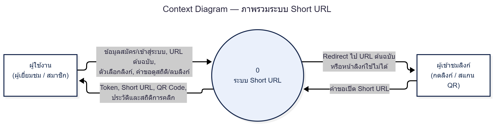
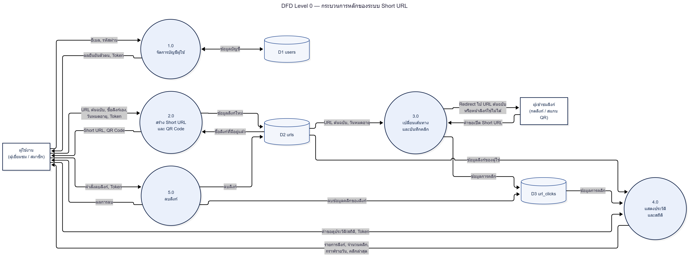
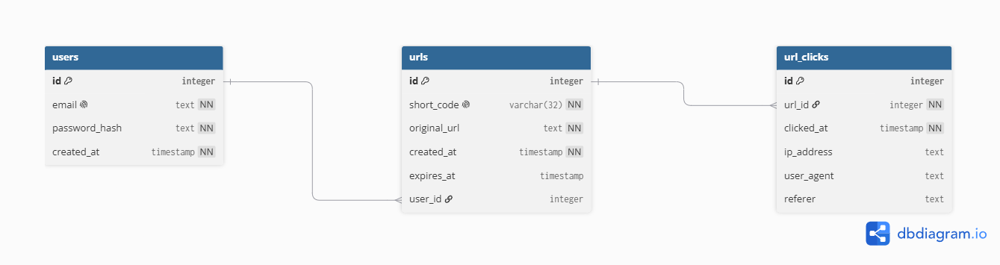
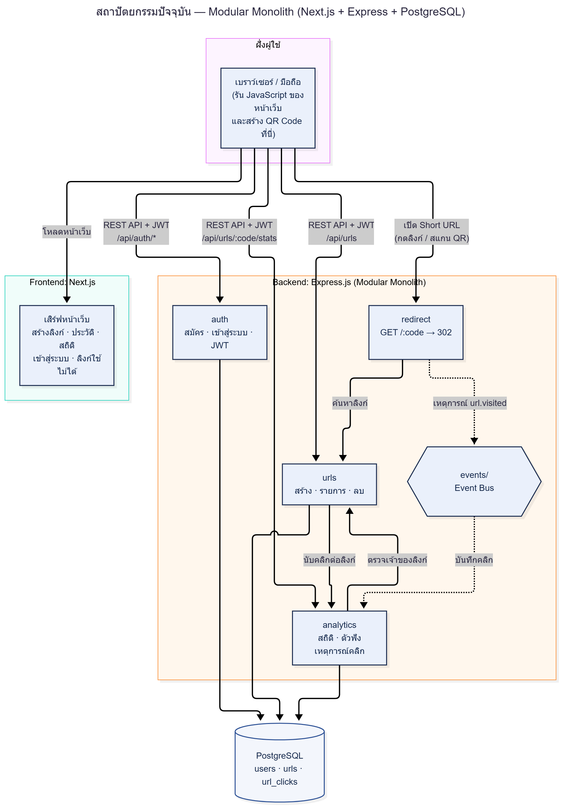
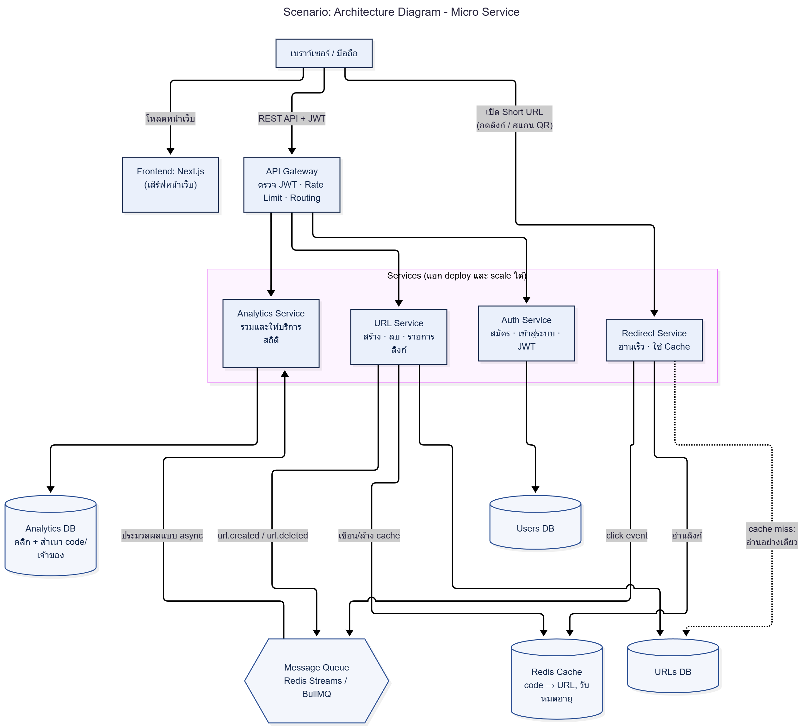

# Short URL

ระบบย่อ URL พัฒนาด้วย **Next.js** (หน้าเว็บ) + **Express.js** (API) + **PostgreSQL** (ฐานข้อมูล) ย่อลิงก์ สร้าง QR Code ดูประวัติและสถิติการคลิก และมีระบบสมาชิก

## สิ่งที่ต้องติดตั้งก่อน

| โปรแกรม | ใช้ทำอะไร | ตรวจว่าติดตั้งแล้ว |
|---|---|---|
| **Node.js** (LTS ล่าสุด แนะนำ 20.9 ขึ้นไป) จาก nodejs.org | รัน backend และ frontend | `node -v` |
| **Git** จาก git-scm.com | โคลนโปรเจกต์ | `git --version` |
| **Docker Desktop** จาก docker.com | รัน PostgreSQL | `docker compose version` |

เปิด Docker Desktop ให้ขึ้นสถานะ **Engine running** ก่อนเริ่ม (บน Windows ต้องเปิดใช้ WSL 2 ตามที่ Docker Desktop แนะนำ)

## วิธีติดตั้งและรัน

คำสั่งใช้ได้ทั้ง Windows (PowerShell) และ macOS/Linux ยกเว้นขั้นตอนคัดลอกไฟล์ที่ให้ไว้ทั้งสองแบบ

### ขั้นตอนที่ 1: โคลนโปรเจกต์

```bash
git clone https://github.com/Theesud/short-url
cd short-url
```

(ถ้าโฟลเดอร์ที่ได้ชื่อต่างจาก `short-url` ให้ `cd` เข้าโฟลเดอร์นั้น)

### ขั้นตอนที่ 2: เปิดฐานข้อมูล PostgreSQL

อยู่ที่โฟลเดอร์หลักของโปรเจกต์ แล้วรัน

```bash
docker compose up -d
docker compose ps
```

ช่อง STATUS ของ `shorturl-postgres` ควรขึ้น `healthy` (ถ้าขึ้น `starting` รอ 10 วินาทีแล้วรัน `docker compose ps` ซ้ำ)

### ขั้นตอนที่ 3: ตั้งค่าและรัน Backend (พอร์ต 4000)

**3.1 ติดตั้งแพ็กเกจ**

```bash
cd backend
npm install
```

**3.2 สร้างไฟล์ `.env` จากตัวอย่าง**

- Windows (PowerShell): `Copy-Item .env.example .env`
- macOS/Linux: `cp .env.example .env`

**3.3 สร้างค่าลับสำหรับ `JWT_SECRET`**

```bash
node -e "console.log(require('crypto').randomBytes(48).toString('hex'))"
```

เปิดไฟล์ `backend/.env` แล้ว **แทนที่ข้อความหลัง `JWT_SECRET=`** ด้วยข้อความยาว ๆ ที่ได้จากคำสั่งข้างบน (ถ้าไม่แทนที่ backend จะไม่ยอมเริ่มทำงาน) ค่าอื่นในไฟล์ใช้ตามตัวอย่างได้เลย

**3.4 สร้างตารางในฐานข้อมูล และบัญชีทดสอบ**

```bash
npx prisma migrate deploy
npx prisma generate
node scripts/seed-demo-user.js
```

**3.5 รัน backend**

```bash
npm run dev
```

ควรเห็น `Backend running on http://localhost:4000` ลองเปิด <http://localhost:4000/health> ควรได้ `{"status":"ok","database":"connected"}` ปล่อย Terminal นี้รันค้างไว้

### ขั้นตอนที่ 4: ตั้งค่าและรัน Frontend (พอร์ต 3000)

เปิด **Terminal ใหม่** ที่โฟลเดอร์หลักของโปรเจกต์ แล้วรัน

**4.1 ติดตั้งแพ็กเกจ**

```bash
cd frontend
npm install
```

**4.2 สร้างไฟล์ `.env.local` จากตัวอย่าง**

- Windows (PowerShell): `Copy-Item .env.example .env.local`
- macOS/Linux: `cp .env.example .env.local`

**4.3 รัน frontend**

```bash
npm run dev
```

เปิดเบราว์เซอร์ที่ <http://localhost:3000> (ครั้งแรกต้องต่ออินเทอร์เน็ตเพื่อโหลดฟอนต์)

### ขั้นตอนที่ 5: ลองใช้งาน

1. หน้าแรก: วาง URL กด **ย่อลิงก์** จะได้ลิงก์สั้นและ QR Code
2. เปิดลิงก์สั้นที่ได้ จะถูกพาไปเว็บปลายทาง
3. เข้าสู่ระบบด้วยบัญชีทดสอบด้านล่าง แล้วเปิดเมนู **ประวัติ** และกด **สถิติ**

## บัญชีทดสอบ

| อีเมล | รหัสผ่าน |
|---|---|
| `demo@example.com` | `Demo@12345` |

สร้างโดยคำสั่ง `node scripts/seed-demo-user.js` ในขั้นตอนที่ 3.4 (มีลิงก์ตัวอย่างและข้อมูลคลิกสาธิตที่สุ่มสร้างให้ เพื่อให้กราฟมีตัวอย่าง) หรือสมัครสมาชิกเองที่ `/register` ด้วยอีเมลอะไรก็ได้ ไม่ต้องมีอยู่จริง ไม่ต้องยืนยันอีเมล รหัสผ่านอย่างน้อย 8 ตัวอักษร

## ฟีเจอร์และเทียบกับเกณฑ์การพิจารณา

| ข้อ | เกณฑ์ | อยู่ตรงไหน |
|---|---|---|
| 1 | DFD Level 0 | [`docs/dfd-context.png`](docs/dfd-context.png), [`docs/dfd-level0.png`](docs/dfd-level0.png) |
| 2 | ER Diagram | [`docs/er-diagram.png`](docs/er-diagram.png) |
| 3 | สร้าง Short URL และกดแล้วไป URL ต้นฉบับ | หน้าแรก `/` |
| 4 | สร้าง QR Code | การ์ดผลลัพธ์หลังย่อลิงก์ (ดาวน์โหลดเป็น PNG ได้) |
| 5 | ประวัติและสถิติการคลิก | `/history` และ `/stats/<รหัสลิงก์>` (ต้องเข้าสู่ระบบ) |
| 6 | ฟังก์ชันเพิ่มเติม | ระบบสมาชิก (JWT), ตั้งชื่อลิงก์เอง, วันหมดอายุ, ลบลิงก์, กราฟสถิติรายวัน, rate limit, หน้าลิงก์ใช้ไม่ได้ |
| พิเศษ | Micro Service + Architecture Diagram | [`docs/architecture-current.png`](docs/architecture-current.png) (ที่ทำจริง), [`docs/architecture-proposed.png`](docs/architecture-proposed.png) (ข้อเสนอ) |

> ระบบที่ส่งเป็น **Modular Monolith** (backend ตัวเดียวที่แยก module ตามหน้าที่: auth, urls, redirect, analytics) ส่วน Micro Service เป็นข้อเสนอการพัฒนาต่อในไดอะแกรมเท่านั้น ยังไม่ได้พัฒนา

## เทคโนโลยีและโครงสร้าง

Next.js 16 (App Router) · Express.js · Prisma 6 · PostgreSQL 16 (Docker) · bcryptjs · jsonwebtoken · express-rate-limit · qrcode

```
short-url/
├── backend/     # Express API (src/modules: auth, urls, redirect, analytics) + prisma/ + scripts/
├── frontend/    # Next.js (src/app = หน้าเว็บ, src/components, src/lib)
├── docs/        # DFD, ER Diagram, Architecture Diagram
└── docker-compose.yml
```

ทดสอบ API ด้วยสคริปต์ (Windows PowerShell) เปิด backend และ Docker ไว้ แล้วรันจากโฟลเดอร์ `backend`: `powershell -ExecutionPolicy Bypass -File .\scripts\test-auth.ps1` และ `test-links.ps1` ผลที่ถูกต้องคือ `Failed: 0`

## ไดอะแกรม











## แก้ปัญหาเบื้องต้น

| อาการ | วิธีแก้ |
|---|---|
| backend แจ้งว่า `JWT_SECRET is missing, too short, or still the example value` | ยังไม่ได้แทนค่า `JWT_SECRET` ใน `backend/.env` (ขั้นตอนที่ 3.3) |
| `docker compose` ต่อ Docker ไม่ได้ | เปิด Docker Desktop ให้ขึ้น Engine running ก่อน |
| `port is already allocated` ที่ 5432 | มี PostgreSQL อื่นใช้พอร์ตนี้ ปิดตัวนั้น หรือเปลี่ยนเป็น `"5433:5432"` ใน `docker-compose.yml` แล้วแก้พอร์ตใน `DATABASE_URL` ของ `backend/.env` ให้ตรง |
| หน้าเว็บขึ้น "เชื่อมต่อเซิร์ฟเวอร์ไม่ได้" | backend ยังไม่ทำงาน หรือ `NEXT_PUBLIC_API_URL` ใน `frontend/.env.local` ไม่ตรงกับพอร์ต backend (แก้แล้วต้องรัน frontend ใหม่) |
| ล็อกอินด้วยบัญชีทดสอบไม่ได้ | ยังไม่ได้รัน `node scripts/seed-demo-user.js` (ขั้นตอนที่ 3.4) |
| PowerShell แจ้ง "running scripts is disabled" | รัน `Set-ExecutionPolicy -Scope CurrentUser RemoteSigned` |
| VS Code ขีดเส้นแดงที่ `url = env("DATABASE_URL")` ใน `schema.prisma` | เป็นคำเตือนจาก extension Prisma รุ่น 7 โปรเจกต์นี้ใช้ Prisma 6 ซึ่งยังต้องมีบรรทัดนี้ ไม่กระทบการทำงาน |

## ข้อจำกัดที่ทราบ

- ไม่มียืนยันอีเมลและไม่มีระบบลืมรหัสผ่าน
- Token เก็บใน `localStorage` (เสี่ยง XSS มากกว่า httpOnly cookie) เลือกแบบนี้เพราะหน้าเว็บกับ backend อยู่คนละโดเมนตอน deploy
- ตัวนับ rate limit เก็บในหน่วยความจำของโปรแกรม (รีสตาร์ทแล้วนับใหม่)
- ลิงก์ที่หมดอายุยังอยู่ในฐานข้อมูล และลิงก์ที่สร้างโดยไม่ล็อกอินดูสถิติไม่ได้